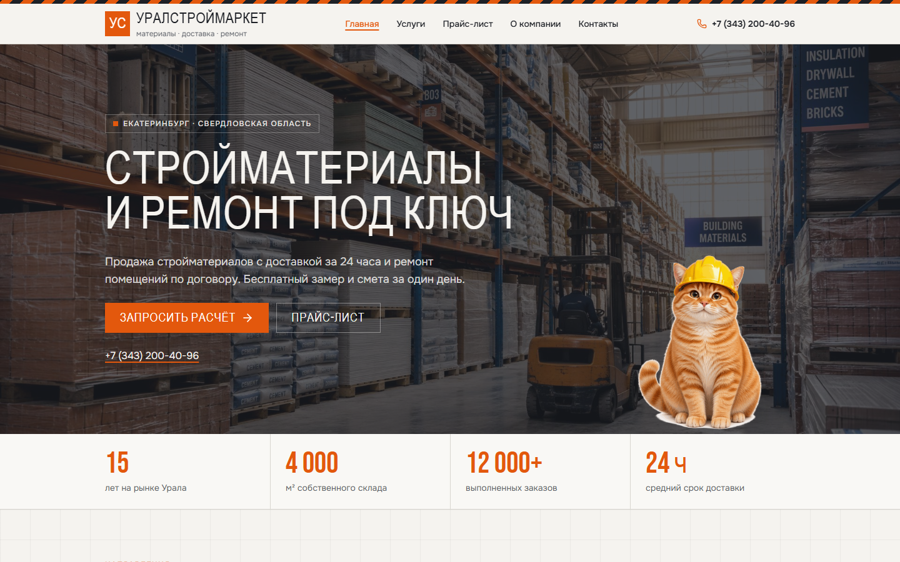

# УралСтройМаркет — демо-сайт по ТЗ

[](https://olga4okan-blip.github.io/uralstroymarket/)

**Сайт опубликован:** https://olga4okan-blip.github.io/uralstroymarket/



Многостраничный сайт компании по строительным материалам и услугам (Екатеринбург),
собранный по учебному техническому заданию: продажа материалов, доставка,
ремонт под ключ, прайс-лист, формы заявок.

- React + TypeScript + Vite + Tailwind CSS
- Изображения сгенерированы локально (папка `public/images`)
- SEO-разметка Schema.org, адаптивная вёрстка

## Запуск

```bash
npm install
npm run dev      # режим разработки
npm run build    # сборка в dist/
```

Демонстрационные данные (бренд, телефоны, цены) — вымышленные.
